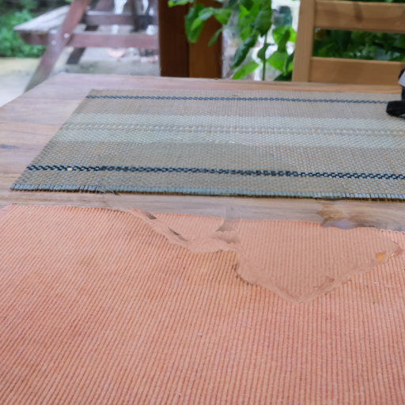
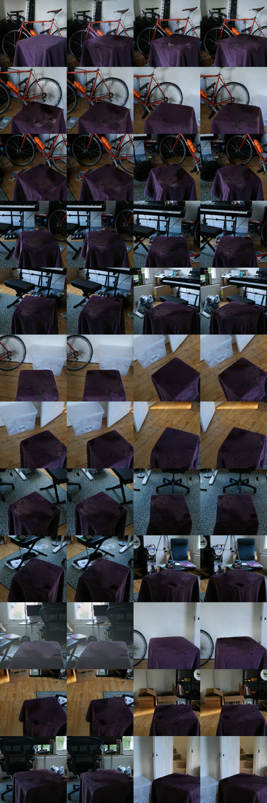

# SpEdE — Splat Edit Engine for ComfyUI

Point at an object in a Gaussian-splat scene and ComfyUI takes it out: SAM 3.1
finds it in every capture camera, a visual hull collects its Gaussians and
deletes them, Qwen-Image 2.1 paints the surface the object hid, MoGe-3
estimates the depth of that repaired view, and SpEdE aligns the depth to the
scene and births new Gaussians only where the hole is. A further step makes
the filled hole hold from every camera, not just the one you edited in. Or
keep the object: **Extract** writes a clean object-only PLY. Or swap it:
**Replace** has Qwen-Image 2.1 turbo draw a new object in its place,
TripoSplat turn it into Gaussians and SpEdE stand it where the old one stood.

Everything runs in your own ComfyUI on your own GPU. No cloud calls, no
partner nodes, no bundled weights, no bundled scenes.

Limits: SpEdE fills the support surface around the removed object (a
tabletop, a floor, a wall, the things behind it that some camera saw). It is
not general 3D inpainting and does not invent hidden objects. When the scene
gives no trustworthy surface, the job fails closed instead of guessing.

## Why this is different

- **The edit is in the scene, not on a picture.** Removal deletes the
  object's Gaussians; the fill births new Gaussians in the scene. They are
  anchored to MoGe-3 depth that is aligned to the scene's own rendered depth,
  so the result is a PLY you can walk around.
- **Every step is judged by a gate.** G1 removal residual, G2 depth alignment
  (depth fill) or plane evidence (planar patch), G3 rendered patch against
  Qwen's edit, H1 other cameras unchanged outside the mask, K1 clean
  extraction. A failed gate stops the job and says why.
- **The all-around fill makes the hole hold from every camera.** A repair
  that looks right in the hero camera can be wrong from the side. The
  independent fill removes the object in every camera that sees it, rebuilds
  the surface under it, paints that surface from above and fits the fill to
  all the cleaned cameras at once.
- **Replace turns one generated picture into an object that stands in the
  scene.** Qwen-Image draws the new object into the scene's own view, so it
  matches the light and the place. TripoSplat lifts that one picture into
  Gaussians, and SpEdE turns it to match Qwen's silhouette, sizes it to the
  old object and stands it on the support plane measured from the scene,
  with a contact shadow. On a finished Remove it builds on the filled scene.
- **Extract cuts the object out, not the table with it.** The selection
  comes from SAM 3.1 in every camera, not one; surface rescue keeps thin
  parts, the support trim cuts it off at the contact line, and small
  detached clusters (a railing behind a truck) are dropped. The result is an
  object-only PLY you can put into another scene.

## What is in the pack

### Nodes

`nodes.py` registers 33 ComfyUI nodes. Their display names are
**SpEdE · \<Name\>**; they sit under **SpEdE Local/…** in the node menu.

| Category | Nodes | What they do |
|---|---|---|
| IO | LoadScene, LoadCameras, CameraImages, MaskView, ViewImage, SaveScene | load the PLY and camera pack, camera photos as images, one view of a mask, save the edited PLY |
| Select | MasksToReport, SelectMultiView, FocusCrop, ObjectName, HeroConsistency | SAM masks to a report, visual hull + contributor vote across cameras, the hero-view check (crop, name, compare click mask with name mask) |
| Extract | Extract | object-only PLY (semantic core, surface rescue, depth clean) |
| Remove | Remove | delete the selected Gaussians |
| Render | Render | gsplat render of a scene in a capture camera |
| Patch | PatchFromDepth, PatchPlane | depth-driven Gaussian births (default); planar support-surface patch (fallback) |
| QA | PatchQA, HeldoutQA | G1/G2/G3 gates; H1 other cameras unchanged |
| Depth | CameraFOV, AlignMoGeDepth | FOV from the camera pack for MoGe-3; align MoGe-3 depth to the scene |
| Replace | ReplaceBase, ObjectCutout, PlaceGenerated; PrepareReplace, RegisterSplat (earlier staging) | the source scene without the extracted object, the new object cut out of Qwen's picture, the TripoSplat object stood on the old object's surface |
| All-around | AllRoundStart, AllRoundHero, AllRoundQwenChain, AllRoundInit, AllRoundWarp, AllRoundLoad, AllRoundOptimize, AllRoundProgressive | plan and run the all-around fill |

### Workflows

`workflows/` holds 10 graphs in ComfyUI API format. They use only these
nodes and ComfyUI core nodes; no other custom nodes.

| File | What it does | Status |
|---|---|---|
| `spede_local_click_sam31_qwen3vl_hero_api.json` | hero check: SAM 3.1 click mask, Qwen3-VL names it, SAM 3.1 finds the name, SpEdE compares | product |
| `spede_local_sam31_extract_api.json` | Extract | product |
| `spede_local_sam31_qwen21_moge3_depthfill_api.json` | Remove + depth fill + gates (the default Remove) | product |
| `spede_local_allround_hero_api.json` | all-around fill, stage 1: plan, clean hero at 1024 px | product |
| `spede_local_allround_progressive_api.json` | all-around fill (Qwen-Image 2.1 turbo): `method` independent (default) or progressive | product |
| `spede_local_sam31_qwen21_patch_api.json` | Remove + planar patch; used without MoGe weights or with `patch_mode: patch` | fallback |
| `spede_local_allround_stage1_api.json` | the orbit path's stage 1: plan, clean hero, Qwen chain, MoGe births, orbit warp | experimental |
| `spede_local_allround_stage2_api.json` | MiniMax H3 orbit video + multi-view optimisation; not in the UI (`allround_mode: orbit`) | experimental |
| `spede_local_replace_api.json` | Replace: Qwen-Image 2.1 turbo draws the new object, SAM 3.1 cuts it out, native TripoSplat makes it 3D, SpEdE stands it where the old one stood (see [docs/REPLACE_V1.md](docs/REPLACE_V1.md)); limits under *Run the UI* | product |
| `spede_local_replace_prepare_api.json` | the earlier Replace staging (bbox-prior merge), kept for reference | experimental |

The JSON files are templates. Inputs are `/PATH/TO/...` placeholders and
outputs go to `JOB` placeholders; `local_sdk.py` fills them. Its
`--prompt-file` option writes the filled graph, which you can read or POST
to ComfyUI's `/prompt` yourself.

### The rest

| Part | What it does |
|---|---|
| `studio/` — the SpEdE web UI | a local FastAPI server that drives your ComfyUI through the Comfy SDK v2: select in 3D or by clicks in a photo, the name check, Extract, Remove, all-around fill, Replace, original/edited 3D compare, camera review |
| `local_sdk.py` | the same workflows from the command line through the Comfy SDK v2 |
| `geometry_cli.py` | camera ranking, 3D pick, and `import-colmap` (COLMAP reconstruction → camera packs) |
| `spede_core/` | the engine: PLY I/O, gsplat rendering, visual hull, extraction, removal, depth fill, planar patch, all-around fill, gates, hero check |
| `gpu_smoke.py`, `examples/`, `tests/` | a real render check, a procedural self-owned scene, example outputs, CPU tests |

## Requirements

- **ComfyUI 0.37 or newer** for the core nodes used: SAM3 *Image
  Segmentation*, Qwen-Image 2.1 with *QwenImage21Cache*, *TextGenerate*,
  *LoadMoGeModel* / *MoGeInference*. **Tested on ComfyUI 0.41.0.** The
  progressive node calls ComfyUI V3 node internals
  (`TextEncodeQwenImage21.execute`, `ManualSigmas`, `CFGGuider`,
  `SamplerCustomAdvanced`), so 0.37–0.40 are untested.
- **Python**: ComfyUI's own venv. Development used Python 3.12.3; CI runs
  3.11.
- **torch** comes from ComfyUI's venv (development: torch 2.9.1+cu130).
- **gsplat 1.5 or newer, built for your torch and CUDA.**
  `rasterize_to_indices_in_range` is required for the contributor maps.
  Development used gsplat 1.5.3 built from source against torch
  2.9.1+cu130. The generic path is `pip install gsplat`: it compiles its
  CUDA code on first import and needs an `nvcc` that matches torch's CUDA.
  The gsplat docs (https://docs.gsplat.studio) list only
  `pip install gsplat` and the source install; we did not find a
  prebuilt wheel index for torch 2.9 + CUDA 13.0 there.
- `pip install -r requirements.txt` (numpy, scipy, Pillow, plyfile,
  gsplat; torch is not listed because it comes from ComfyUI's venv) and,
  for the UI and the SDK runner, `pip install -r studio/requirements.txt`
  (fastapi, uvicorn, pydantic, httpx, comfy-sdk 0.4.0, comfy-api-proxy
  0.1.6; the last two are pinned). For camera packs from COLMAP:
  `pip install pycolmap`.
- **Same machine.** The UI and `geometry_cli.py` must run with ComfyUI's venv
  Python on the machine that runs ComfyUI: they read `comfy_root/output` and
  start gsplat subprocesses.
- **RAM**: 64 GB recommended. Depth fill needs about 16 GB and the
  all-around fill runs under a 30 GB reservation (the progressive fill's
  21 Oct 2026 run peaked at about 26 GB), on top of ComfyUI.
- **GPU**: an NVIDIA GPU with CUDA; gsplat and every model run on it.
  **VRAM**: only 32 GB (RTX 5090) has been tested.
- **Disk**: about 27 GB of weights for the product path, 3.3 GB more for
  Replace (TripoSplat) and about 43 GB more for the experimental orbit;
  about 1.4–2.1 GB of ComfyUI output per all-around run.
- **Network at first start**: the UI downloads three.js 0.170.0 and
  GaussianSplats3D 0.4.7 (both MIT) from jsDelivr into `<runs>/viewer`. Its
  pages load the Jost and IBM Plex Mono fonts from Google Fonts.

## Install

~~~bash
cd /path/to/ComfyUI/custom_nodes
git clone https://github.com/Burgstall-labs/ComfyUI-SpEdE ComfyUI-SpEdE
cd ComfyUI-SpEdE
/path/to/ComfyUI/venv/bin/python -m pip install -r requirements.txt -r studio/requirements.txt
~~~

Use the Python of ComfyUI's venv so that torch and gsplat match. Restart
ComfyUI. The nodes appear under **SpEdE Local/…**; the pack adds no menu
buttons or front-end extensions.

## Weights

You download them; none are bundled, and each keeps its own licence.
Downloading the weights yourself does not give you commercial rights to
their output.

Product path:

| File under `ComfyUI/models/` | Size | Model and use | Source | Licence |
|---|---|---|---|---|
| `checkpoints/sam3.1_multiplex_fp16.safetensors` | 1.7 GB | SAM 3.1 (Meta): segmentation by clicks and by name | https://huggingface.co/Comfy-Org/sam3.1 (the file ComfyUI's [SAM3 blueprint](https://github.com/Comfy-Org/ComfyUI/blob/master/blueprints/Image%20Segmentation%20(SAM3).json) downloads) | SAM License |
| `diffusion_models/qwen_image_2.1_int8_convrot.safetensors` | 7.3 GB | Qwen-Image 2.1: hero repair in the depth fill and the planar patch, all-around stage 1, the earlier Replace staging | https://huggingface.co/Comfy-Org/Qwen-Image-2.1 | [Qwen-Image 2.1 Research License](https://huggingface.co/Qwen/Qwen-Image-2.1/blob/main/LICENSE) (non-commercial) |
| `diffusion_models/qwen_image_2.1_turbo_int8_convrot.safetensors` | 7.3 GB | Qwen-Image 2.1 turbo: all-around fill, Replace | same | same |
| `text_encoders/qwen3vl_8b_int8_convrot.safetensors` | 9.4 GB | Qwen3-VL 8B: Qwen-Image 2.1's text encoder; also names the selection in the hero check through core *TextGenerate* | same | distributed with Qwen-Image 2.1; treated here under the same research terms |
| `vae/qwen_image_2.1_vae_bf16.safetensors` | 0.7 GB | Qwen-Image 2.1 VAE | same | same |
| `geometry_estimation/moge_3_vitl_fp16.safetensors` | 0.7 GB | MoGe-3 ViT-L (Microsoft): depth of the repaired views (depth fill, all-around) | https://huggingface.co/Comfy-Org/MoGe | MIT |

Experimental orbit only (`spede_local_allround_stage2_api.json`; not needed
for the product path):

| File under `ComfyUI/models/` | Size | Source | Licence |
|---|---|---|---|
| `diffusion_models/minimax_h3_ref2va_pruned_int8_convrot.safetensors` | 21 GB | https://huggingface.co/Comfy-Org/MiniMax-H3 | minimax-h3-community-license-agreement (as the model card names it) |
| `vae/minimax_h3_video_vae_int8_convrot.safetensors` | 3.2 GB (our copy; the file now on Hugging Face is 2.8 GB) | same | same |
| `vae/minimax_h3_audio_vae_fp32.safetensors` | 0.6 GB | same | same |
| `text_encoders/qwen3vl_32b_minimax_h3_nvfp4_awq.safetensors` | 15.7 GB | same | same |
| `loras/H3/minimax_h3_dmd_ref2va_8step_turbo_pruned.safetensors` | 2.3 GB | https://huggingface.co/drbaph/MiniMax-H3-Turbo-Lora-ComfyUI (`experimental/` folder) | card tag apache-2.0; a derivative of MiniMax H3, whose licence also applies |
| `loras/H3/MiniMax-H3_Ref2VA-LoRA-CrossView-Warp_v1_3500.safetensors` | 0.6 GB | https://huggingface.co/Cseti/MiniMax-H3_Ref2VA-LoRA-CrossView-Warp_v1 (Cseti) | MiniMax H3 Community License Agreement (per the card) |

The SAM 3.1 and Qwen-Image 2.1 base, encoder and VAE names are the ones the
official [Qwen-Image 2.1 image edit](https://github.com/Comfy-Org/workflow_templates/blob/main/templates/image_qwen_image_2_1_image_edit.json)
template and the SAM3 blueprint use. The MoGe-3, Qwen turbo and orbit names
are the file names in the repositories cited in the tables. Other quantisations work if you change the names in
`workflows/*.json` (or pass `checkpoint_names` to
`local_sdk.build_local_graph`). Extract needs only SAM 3.1. Without the MoGe
weights, use the planar fallback (`patch_mode: patch`).

Replace also uses ComfyUI's native TripoSplat nodes and these files (the
ones `spede_local_replace_api.json` names and ComfyUI's *Image to Gaussian
Splat (TripoSplat)* blueprint downloads). Nothing else needs them.

| File under `ComfyUI/models/` | Model and use | Source | Licence |
|---|---|---|---|
| `diffusion_models/triposplat_fp16.safetensors` | TripoSplat (VAST): the new object as Gaussians | https://huggingface.co/VAST-AI/TripoSplat (code: https://github.com/VAST-AI-Research/TripoSplat) | MIT (code and weights, per its README) |
| `vae/triposplat_vae_decoder_fp16.safetensors` | TripoSplat Gaussian decoder | same | MIT |
| `clip_vision/dino_v3_vit_h.safetensors` | DINOv3 ViT-H+ (Meta): TripoSplat's image encoder | same repository | [DINOv3 License](https://ai.meta.com/resources/models-and-libraries/dinov3-license/) (Meta; use restrictions) |
| `vae/flux2-vae.safetensors` | FLUX.2 autoencoder (Black Forest Labs): TripoSplat's latent space | same repository | Apache-2.0 (the FLUX.2 VAE only; FLUX.2 [dev] itself is non-commercial) |

## Scene data

A scene is a 3DGS **PLY** in the standard Inria layout (`x y z`, `f_dc_*`,
`f_rest_*`, `opacity`, `scale_*`, `rot_*`; extra per-Gaussian properties are
preserved) and a **camera pack** NPZ: `targets` `[N,H,W,3]` uint8 (the real
photos, square), `labels`, `viewmats` `[N,4,4]` world→camera, `intrinsics`
`[N,3,3]`, `frame_indices`. The hero camera must be in the pack, and at
least three other cameras should see the object. The H1 gate judges the
other capture cameras of this pack outside the mask.

- **From a COLMAP reconstruction** (for example a Mip-NeRF 360 scene with the
  3DGS model trained on it):

  ~~~bash
  pip install pycolmap
  python geometry_cli.py import-colmap --sparse-dir scene/sparse/0 --images-dir scene/images_4 \
      --out-dir scene/cameras --size 512 --hero DSCF5565.JPG
  ~~~

  `--hero` takes the COLMAP image file name with its extension
  (`DSCF5565.JPG` for bonsai, `DSCF0669.JPG` for kitchen); the camera pack
  labels it without the extension (`DSCF5565`). This writes
  `edit_cameras.npz` and `heldout_cameras.npz` (Mip-NeRF 360 convention:
  every 8th image is a held-out candidate). By default the held-out pack keeps 8
  of those candidates and the edit pack 24 cameras (the hero plus 23 of the
  other images), spread evenly along the capture (`--heldout-count`,
  `--edit-count`); the hero is always an edit view.
  The held-out pack is not used by any workflow. Images are centre-cropped to
  a square and resized to `--size`; poses stay in the COLMAP world the 3DGS
  model was trained in.
- **Development scenes**: Mip-NeRF 360 (Barron et al., CVPR 2022) *bonsai*
  (hero `DSCF5565`) and *kitchen* (hero `DSCF0669`). The captures are on the Mip-NeRF 360 page
  (https://jonbarron.info/mipnerf360/, "Dataset Pt. 1", `360_v2.zip`). The
  pretrained 3DGS models are linked from the 3DGS code repository
  (https://github.com/graphdeco-inria/gaussian-splatting, "Pre-trained
  Models (14 GB)"); the project page is
  https://repo-sam.inria.fr/fungraph/3d-gaussian-splatting/ .
- **`photos`**: the all-around fill needs the capture's full-resolution
  `images/` folder for a sharp 1024 px hero. Set it per scene in the UI
  config. The 1024 hero check rejects a folder that does not match the
  camera pack.
- **A procedural, self-owned scene** for a first run, no downloads needed
  (a red ball on a floor, eight cameras `camera_0`…`camera_7`). From the
  pack folder, with ComfyUI's venv Python:

  ~~~bash
  python examples/make_demo_fixture.py --out /tmp/spede-fixture
  # GPU: gsplat render of the fixture and its per-pixel contributors
  python gpu_smoke.py --source-ply /tmp/spede-fixture/synthetic_scene.ply \
      --camera-targets /tmp/spede-fixture/cameras.npz
  # CPU: build the Extract graph for the fixture and submit nothing
  # (comfy-sdk installed; COMFY_BASE_URL must be set, it is not contacted)
  COMFY_BASE_URL=http://127.0.0.1:8189 python local_sdk.py extract \
      --source-ply /tmp/spede-fixture/synthetic_scene.ply \
      --camera-targets /tmp/spede-fixture/cameras.npz \
      --hero-view camera_0 --object-text "red ball" --prompt-file /tmp/extract.json
  ~~~

  `--object-text` is required for `extract`: it is SAM 3.1's text prompt
  in the graph. The fixture proves rendering and extraction geometry only,
  not SAM or Qwen quality.

No scenes ship with the pack. Mip-NeRF 360 captures and pretrained Inria
models have their own terms; do not redistribute them with your results.
The demo video also shows the *Truck* scene of Tanks and Temples (Knapitsch
et al., SIGGRAPH 2017, https://www.tanksandtemples.org/); it is not
distributed either. Dataset credits are in `THIRD_PARTY.md`.

## Run the UI

1. Start ComfyUI, then the Comfy SDK proxy on the same machine:

   ~~~bash
   comfy-api-proxy run --comfyui http://127.0.0.1:8188 --host 127.0.0.1 --port 8189
   ~~~

   Keep the proxy on loopback. Port 8189 is the SDK; 8188 is ComfyUI itself.
2. `cp studio/config.example.json studio/config.json` and set:
   - `comfy_root` (required): the ComfyUI directory; results are read from
     its `output/`;
   - `scene_root` and `scenes`: per scene the PLY, camera pack, hero camera
     label and `photos`;
   - `comfy_host` / `comfy_port` if ComfyUI is not at `127.0.0.1:8188`;
     `comfy_sdk_url` for the proxy; `runs` for the UI's run folder;
     `cuda_device`;
   - `patch_mode`: `depthfill` (default) or `patch` (planar fallback);
   - `allround_mode`: `independent` (default), `progressive` (camera by
     camera, slower) or `orbit` (experimental);
   - `accept_qwen_research_license`: must be `true` before the UI submits
     any graph that uses Qwen. Set it only if you accept the Qwen-Image 2.1
     Research License.

   Every scalar key can also come from `SPEDE_<KEY>` in the environment
   (not `scenes`); `SPEDE_CONFIG` points at another config file.
3. `python studio/server.py --host 127.0.0.1 --port 8090` with ComfyUI's
   venv Python, and open http://127.0.0.1:8090 .
4. Edit:
   1. **Projects → pick a scene → Start editing.** The scene opens in 3D.
   2. **Select.** Walk through the scene (drag to look, W A S D to move) and
      click the object. SpEdE jumps to the real camera that sees it best and
      runs the name check there: SAM 3.1 masks the click, Qwen3-VL names the
      mask and SAM 3.1 looks for that name in the same view. The check page
      shows the camera photo with the selection in red:
      - **Looks right → Remove** goes on to step 2;
      - **Or:** **Extract it** writes a clean object-only PLY and shows it in
        3D; **Replace it with…** opens the Replace form (below);
      - **Not right?** **Refine with points** places include/exclude points
        in the photo (Shift-click or right-click for exclude), **Back to 3D**
        clicks again.

      When the click and the name disagree, the page shows both outlines and
      you pick one or type another name. The **Cameras** tab lists the
      cameras that see the object and lets you pick another edit camera.
   3. **Remove → Remove and patch.** One ComfyUI job of about a minute:
      removal, Qwen-Image 2.1's repair of the edit camera, MoGe-3 depth fill
      and the checks.
   4. **Result.** The original and the edited scene side by side in 3D (drag
      either; Space for A/B), the checks in words (numbers under Details),
      the PLY to download and **Walk through it**.
      - **Make it hold from every direction** runs the all-around fill:
        stage 1 (plan, clean edit camera), then the independent fill, about
        10 min on an RTX 5090 (kitchen experiment, 23 Oct 2026; the
        progressive fill took 16–24 min). It needs `patch_mode: depthfill`
        and works best with `photos`. Run it before Replace: it is not
        offered after one.
      - **Replace with…**: type what to put there, optionally add a
        picture, pick a size (Match, Natural, Larger) and press **Replace**.
        Each press draws a new version.
      - **Edit another object (new project)** opens the scene again in 3D.
        Edits do not stack: it starts from the original scene.

   **Replace** also works straight from the check page, without a
   Remove: the old object goes exactly as Extract cuts it. One ComfyUI job of
   about a minute (a few more when it has to extract first). Limits:
   - TripoSplat invents the back side of the new object: it looks best from
     within about ±15° of the edit camera;
   - one replacement per project (replacing again swaps it; Remove again
     sets it aside);
   - the old object's cast shadow beyond its footprint stays in the scene.

Results are written to `ComfyUI/output/spede/local/<job>/` (all-around:
`ComfyUI/output/spede/allround/<job>/`) and copied into the UI's
`runs/<project>/` folder with every job's log.

## Command line (Comfy SDK v2)

`local_sdk.py` runs `extract`, `patch`, `depthfill`, `hero` and
`replace_prep`. There is no command-line all-around fill; use the UI.

~~~bash
export COMFY_BASE_URL=http://127.0.0.1:8189

# dry run: build the graph, check the weights, submit nothing
# (needs COMFY_BASE_URL and comfy-sdk installed)
python local_sdk.py depthfill --source-ply scene/point_cloud.ply --camera-targets scene/cameras/edit_cameras.npz \
    --hero-view DSCF5565 --object-text "bonsai tree" --job-name bonsai1 \
    --prompt-file /tmp/bonsai1.json --comfy-root /path/to/ComfyUI

# submit the real GPU job
python local_sdk.py depthfill --source-ply scene/point_cloud.ply --camera-targets scene/cameras/edit_cameras.npz \
    --hero-view DSCF5565 --object-text "bonsai tree" --job-name bonsai1 \
    --accept-qwen-research-license --submit
~~~

`--comfy-root` checks that the weights are present. Every operation that
loads a Qwen model (including `hero`, whose naming uses the Qwen3-VL
encoder) refuses to submit without `--accept-qwen-research-license`;
`extract` needs no such flag. In the development repository the module is
`python -m competition.local_sdk`.

## Tests and checks

~~~bash
pip install pytest httpx fastapi pydantic        # plus torch (CPU is fine) for the multi-view tests
python -m pytest -q tests/
python gpu_smoke.py --source-ply scene/point_cloud.ply --camera-targets scene/cameras/edit_cameras.npz
~~~

The CPU tests cover the engine, the nodes, the workflows and the UI.
`gpu_smoke.py` renders non-empty alpha and contributor maps and validates
Gaussian indices against the source rows. Passing CPU tests says nothing
about model quality: judge the result in other cameras (the H1 gate) and in
the 3D compare.

## Example outputs

`examples/outputs/<scene>/` holds results for *bonsai* and *kitchen*:
`qwen_edit.png` (Qwen's repair of the hero view), `patched_render.png` (the
edited scene rendered in the hero camera), `depth_preview.png` (the aligned
depth), `progressive_sheet.png` (the progressive fill in other cameras),
`gates.json` and `timings.json`.

How the fills work, with the measured numbers and what was tried:
[docs/DEPTH_FILL_V2.md](docs/DEPTH_FILL_V2.md),
[docs/ALLROUND_FILL.md](docs/ALLROUND_FILL.md),
[docs/REPLACE_V1.md](docs/REPLACE_V1.md).

## Not in this release

- A panel inside the ComfyUI front end. The UI is a separate local page.
- A hosted or cloud path. Everything is local.
- The MiniMax H3 orbit in the UI. It stays an experimental workflow.
- A Qwen-Image-Edit-2511 variant.

## Licence

This pack is free software under the **GNU AGPL-3.0-or-later** (see `LICENSE`
and `NOTICE`). Burgstall Labs is the sole copyright holder. It is the open
SpEdE subset of Burgstall Labs' Splatedit Studio; Studio proper, AccGS and
Splatedit are separate, unpublished software. Third-party code, model
weights, datasets and ComfyUI itself keep their own licences
(`THIRD_PARTY.md`); an edited scene carries the restrictions of every model
and input that produced it.
